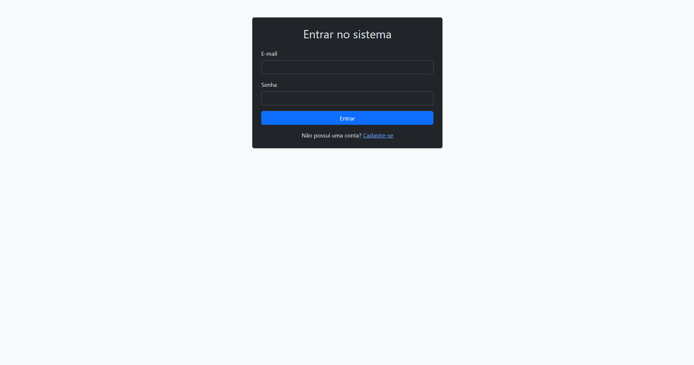
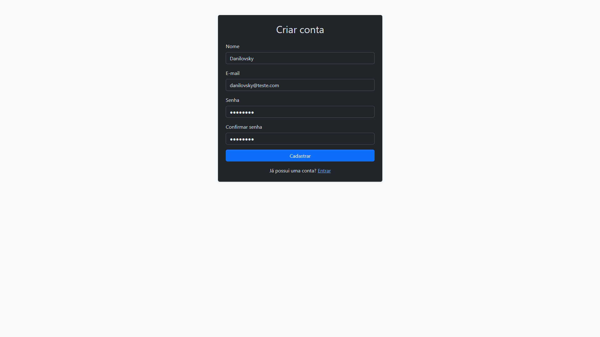
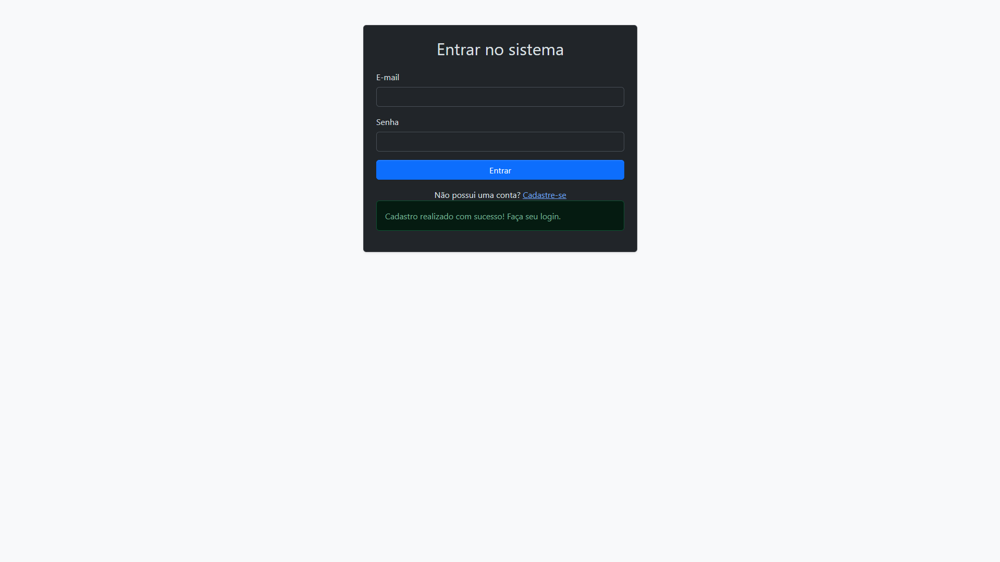
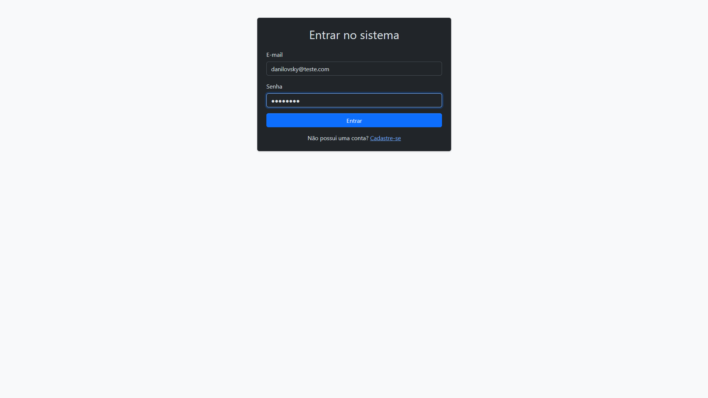
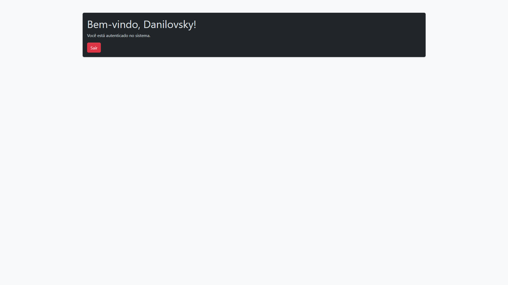
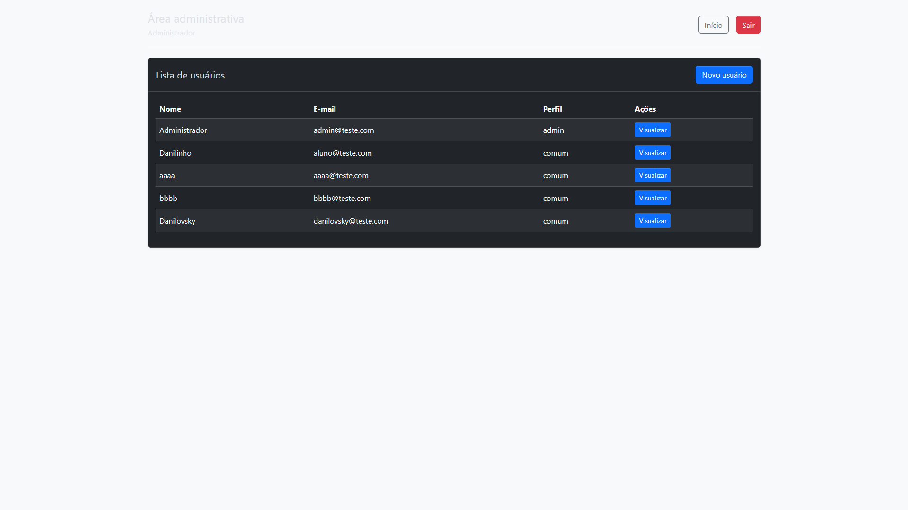
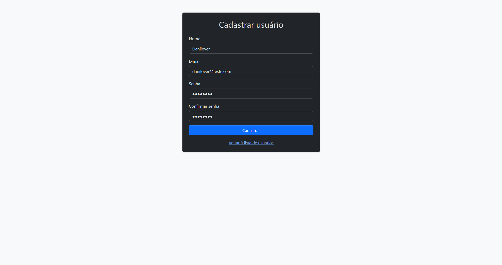
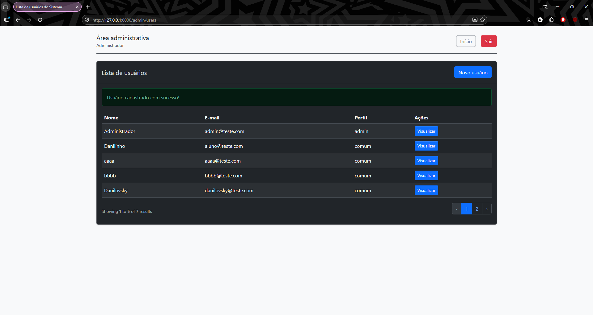
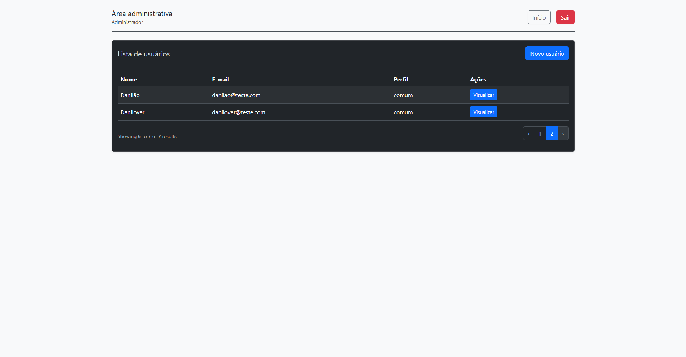

# Autenticação e Área Administrativa — Laravel

Atividade prática desenvolvida para a disciplina de Laravel do curso de **Sistemas para Internet — UniALFA**. O projeto implementa autenticação baseada em sessão, cadastro de usuários e autorização para acesso administrativo.

## Funcionalidades

- Login com validação, mensagem genérica para credenciais inválidas e preservação do e-mail informado.
- Regeneração do identificador de sessão após autenticação e limitação de tentativas de login (`throttle:5,1`: até cinco requisições por minuto na rota).
- Cadastro público com validação, confirmação de senha e criação de perfil `comum`.
- Redirecionamento após login: usuário comum para `/` e administrador para `/admin/users`, respeitando destino interno previamente solicitado quando aplicável.
- Proteção das rotas administrativas com `auth` e middleware de perfil `admin`.
- Resposta HTTP **403** para usuário autenticado sem autorização administrativa.
- Cadastro de usuários comuns pelo painel administrativo, com retorno à listagem e mensagem de sucesso.
- Listagem de usuários com paginação Bootstrap 5.
- Logout via requisição POST com CSRF, invalidação da sessão e renovação do token CSRF.

## Tecnologias

- PHP 8.3+ e Laravel 13
- Blade e Vite
- Bootstrap 5
- Eloquent ORM e banco de dados SQLite (ambiente de demonstração)
- Testes automatizados do Laravel/Pest

## Rotas principais

| Método | Caminho | Acesso | Finalidade |
| --- | --- | --- | --- |
| GET | `/login` | Público | Exibir login |
| POST | `/login` | Público | Autenticar usuário |
| GET | `/register` | Público | Exibir cadastro público |
| POST | `/store` | Público | Criar usuário comum |
| GET | `/` | Autenticado | Página inicial |
| POST | `/logout` | Autenticado | Encerrar sessão |
| GET | `/admin` | Administrador | Painel administrativo |
| GET | `/admin/users` | Administrador | Listar usuários |
| GET | `/admin/users/create` | Administrador | Formulário de novo usuário |
| POST | `/admin/users` | Administrador | Salvar novo usuário |
| GET | `/admin/users/{id}` | Administrador | Visualizar usuário |

## Execução local

Requisitos: PHP, Composer, Node.js e npm instalados.

```bash
composer install
npm install
```

Crie o arquivo `.env` a partir de `.env.example`, configure `DB_CONNECTION=sqlite` e gere a chave:

```bash
php artisan key:generate
php artisan migrate
```

Crie `database/database.sqlite` caso o arquivo ainda não exista. Para desenvolvimento, inicie o servidor e o Vite em terminais separados:

```bash
php artisan serve
```

```bash
npm run dev
```

> **Administrador de demonstração:** deve ser provisionado localmente e de forma controlada, atribuindo `type = admin` ao perfil de um usuário existente. O cadastro público nunca permite escolher esse perfil. Não publique senhas de teste nem credenciais reais no repositório.

## Testes

Execute:

```bash
php artisan test
```

**Resultado obtido na execução local da atividade:** 12 testes aprovados, 29 asserções, nenhuma falha. Foram verificados cadastro público, cadastro administrativo, autorização, redirecionamentos, login e logout.

## Evidências visuais

As imagens abaixo registram a demonstração manual em ordem de fluxo. Os dados exibidos são contas de teste locais.

### 01. Acesso de visitante

A página de login é exibida para visitantes. Rotas protegidas exigem autenticação.



### 02. Cadastro público

O formulário independente permite informar nome, e-mail, senha e confirmação.



### 03. Confirmação do cadastro público

Após o cadastro, o visitante retorna ao login e recebe uma mensagem de sucesso. O perfil criado é `comum`.



### 04. Login de usuário comum

O usuário informa suas credenciais para iniciar uma sessão autenticada.



### 05. Página inicial autenticada

Após o login, o usuário comum é direcionado à página inicial `/`.



### 06. Acesso administrativo negado

Uma conta comum que tenta abrir a área administrativa recebe a resposta HTTP **403**.


### 07. Listagem administrativa

O administrador pode visualizar os usuários cadastrados e os respectivos perfis.



### 08. Cadastro realizado pelo administrador

A área administrativa oferece formulário para cadastrar outro usuário sem conceder privilégios de administrador.



### 09. Confirmação do cadastro administrativo

Após salvar, o administrador retorna à lista e visualiza a confirmação de sucesso.



### 10. Paginação e perfil do novo usuário

A segunda página exibe o novo usuário com perfil `comum`, comprovando o resultado do cadastro.



### 11. Logout

Ao sair, a sessão é encerrada e o usuário retorna ao login. Uma nova tentativa de acessar `/admin/users` exige autenticação.


## Segurança e controle de acesso

A autenticação identifica quem está conectado; a autorização verifica se o perfil permite entrar na área administrativa. Por isso, uma conta `comum` pode estar autenticada e ainda assim receber **403** ao acessar `/admin/users`. O bloqueio é aplicado no servidor pelo middleware, não apenas pela interface.

O logout utiliza **POST com CSRF**, e a aplicação não oferece criação pública de administradores.

## Entrega

Implementação realizada em branch própria do fork, para apresentação por Pull Request ao repositório da atividade. As capturas documentam os cenários solicitados no enunciado.
